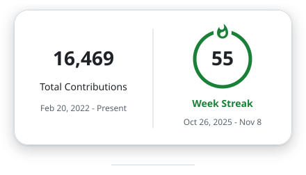

  <em>I’m obsessive about the code I write and I know that. 
  The kind who’ll leave a PR comment asking to rename a request-body alias from 'sp' to 'spk', not because anyone asked, but because 'spk' feels right cause I want my codebase to be PERFECT.</em>

  <picture>
    <source media="(prefers-color-scheme: dark)" srcset="https://raw.githubusercontent.com/anandakrishnone/anandakrishnone/output/streak-dark.svg">
    
  </picture>
   
  Most of my contributions are private, but you can contact me through

  
  &nbsp;&nbsp;&nbsp;
  <a href="https://x.com/anandakrishnone"><picture><source media="(prefers-color-scheme: dark)" srcset="https://github.com/anandakrishnone/anandakrishnone/raw/master/assets/logos/x-dark.svg"></picture></a>
  &nbsp;&nbsp;&nbsp;
  
  &nbsp;&nbsp;&nbsp;
  

